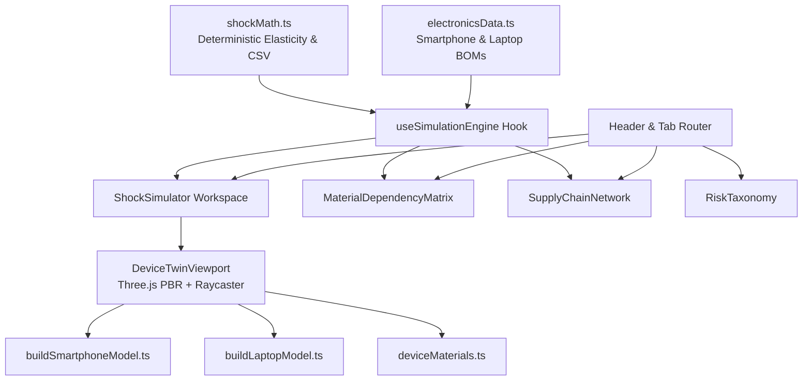

# CircuitTwin — Electronics SCM Digital Twin

[](https://vitejs.dev/)
[](https://react.dev/)
[](https://www.typescriptlang.org/)
[](https://threejs.org/)
[](https://vitest.dev/)

CircuitTwin is a client-side **Supply Chain Management (SCM) Digital Twin & Commodity Price Shock Simulator** built for flagship **Smartphones** and **Workstation Laptops**. It maps hardware Bills of Materials (BOMs) directly to global semiconductor, display, battery, metal, and air/ocean freight indices so procurement and hardware engineering teams can stress-test unit costs and mitigation levers in real time.

## Key Capabilities

- **Dual Hardware Platforms**: Switch instantaneously between a **Flagship 5G Smartphone (256GB)** and a **16" Pro Workstation Laptop (1TB)**, each decomposed into 7 selectable hardware sub-assemblies.
- **Interactive 3D Device Digital Twin**: Composite Three.js WebGL models with exploded-layer damping, X-Ray inspection (`Auto` / `Solid` / `X-Ray`), raycast click-to-select, and dynamic shock stress highlighting.
- **Market Shock Studio & Geopolitical Presets**: Adjust 9 electronics-specific commodity indices (`TSMC / Foundry Index`, `DRAM/NAND Spot Index`, `SOX Index`, `Display Panel Index`, `Lithium & Battery Index`, `LME Copper`, `LME Aluminum`, `Rare Earth Index`, `Air & Ocean Freight`) or trigger one-click scenarios such as *Foundry Capacity Crunch* and *DRAM / AI Server Squeeze*.
- **Mitigation Levers**: Toggle **Nearshored Sourcing** (India / Vietnam / Mexico corridors reducing freight elasticity by 75%) and **Engineering BOM Substitutions** (e.g., dual-sourced 4nm SoC, Oxide IPS panel fallback, recycled aluminum chassis).
- **Multi-Screen Intelligence**:
  - **Simulator**: 3D twin, 6-month landed cost trajectory, material sensitivity breakdown, and total device BOM rollup.
  - **BOM Matrix**: Searchable, sortable, filterable cost sensitivity table (responsive card stack on mobile) with formula-safe CSV export.
  - **Supply Network**: Interactive radial topology connecting OEM integration, Tier-1 EMS suppliers, and Tier-2 raw material indices.
  - **Risk Taxonomy**: Structural chokepoint breakdown and deterministic pricing formula reference.

## Architecture



## Getting Started

```bash
# 1. Install dependencies
npm install --legacy-peer-deps

# 2. Start local development server (port 3000)
npm run dev

# 3. Run unit & integration test suite
npm test

# 4. Type-check and build production bundle
npm run lint
npm run build
```

## Automated GitHub Pages Deployment

The repository includes `.github/workflows/deploy.yml`, which automatically runs `npm install --legacy-peer-deps`, executes the Vitest suite (`npm test`), builds the static Vite bundle with Node.js 22, and deploys `./dist` to GitHub Pages on every push to `main`.
